# Appearance redesign

## Why the old screen was hard to use

The previous Appearance screen put the theme preview, palette, brightness, message animations, wallpapers and the
entry to the advanced editor into one long scroll. The same choices were demonstrated three times by different
previews, the animation editor embedded a second full chat and two direction editors, and the top preview could
push the settings a whole screen down. On narrow screens the animation direction and easing rows scrolled
horizontally, so options were cut off. Sliders used tick marks and a tall Material slider thumb, which read as
vertical bars rather than controls.

The audit also found these problems:

- the page never said clearly whether the current edits were applied;
- leaving a subsection was the only way to discover the next one;
- the animation preset carousel made comparing a dozen effects slow;
- changing one direction in independent mode repeated the whole preset gallery;
- the draft was stored correctly, but the screen did not expose that model clearly;
- blur/dim controls for a photo were disconnected from the preview;
- contrast problems were explained only inside the old editor.

## Information architecture

Appearance is now one entry point with a small page stack and one shared draft:

- **Overview** — compact, live chat fragment, section cards, and the current palette/brightness, message style,
  animation mode and wallpaper. A second group opens the expert colour controls.
- **Theme and colours** — palette, brightness (including AMOLED), a short colour sample and the expert entry.
- **Messages** — bubble shape, radius, text size, line spacing, density and message colours.
- **Message animations** — one live preview, linked/independent directions, the full preset gallery grouped by
  character, and contextual fine tuning.
- **Chat wallpaper** — pattern grid, solid/gradient colours, and gallery photos with dim/blur.
- **Custom colours** — accent, outgoing bubble, message text and time colours, with contrast checks.
- **Full-screen preview** — incoming/outgoing messages, a reply, media, a service event, the wallpaper and the
  composer, animated with the saved preset.

The Apply bar stays visible on every editing page. The draft is shared by every subsection, survives navigation and
Activity recreation, and is shown in the previews before it is applied. The system Back button returns from a
subsection to Overview first; leaving a dirty Overview asks before discarding. A single Undo action tracks the
shared draft (slider bursts are coalesced into one step).

## Preview and Composer Launch

The compact preview is a real chat fragment: it uses `ChatWallpaperLayer`, the real bubble metrics/shape and the
draft theme. It does not repeat the chat header or fill space with demo messages. The animation page adds the
composer because Composer Launch has to start there.

The full preview and the animation card use `MessageAnimationFrame` and `ComposerLaunchLayer`, the same mechanisms
as the chat. Composer Launch is measured from the preview field to the destination bubble, clears the field while the
bubble flies, and can be replayed. Nothing is sent to Telegram. Linked Composer Launch still shows the BeyGram Flow
fallback for incoming messages.

## Animation selection and tuning

The preset carousel is replaced by two-column cards with distinguishable start/end bubble thumbnails. Presets are
grouped as simple, BeyGram signature and custom. In independent mode the two directions are selected with two
compact tabs that show the current preset for each side, so the gallery is not duplicated. Tuning is collapsed by
default and only contains controls that the selected preset actually uses. Direction and easing are wrapping chips,
not horizontal scroll rows. Sliders have a circular thumb and no tick dots.

## Screenshots

| Dark | Light | AMOLED |
| --- | --- | --- |
| 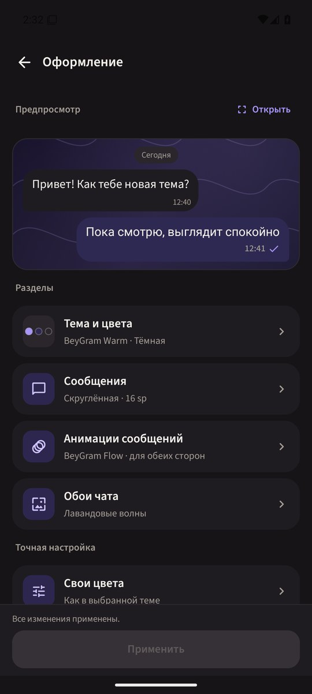 | 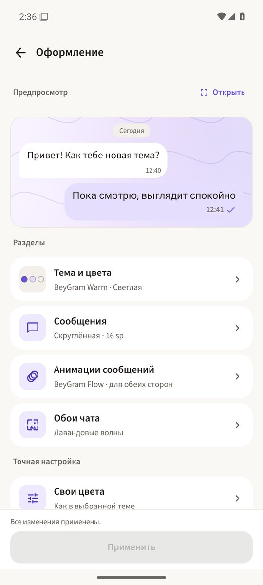 | 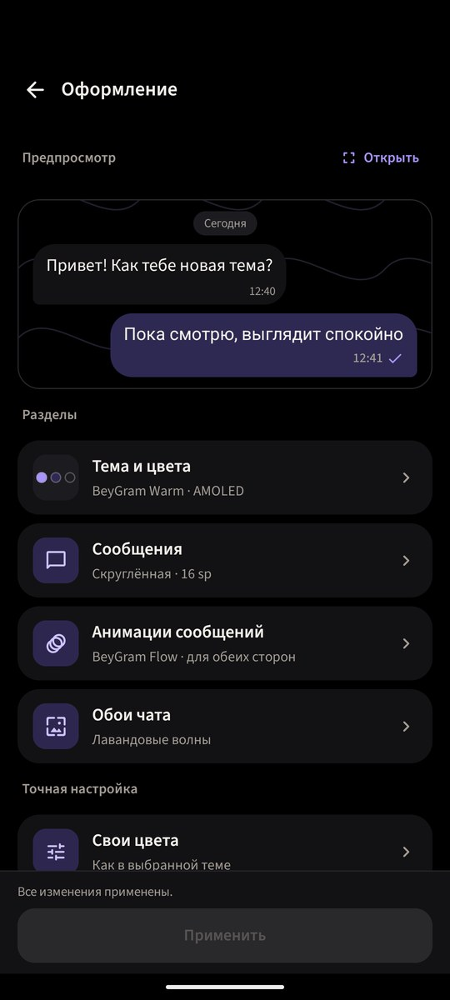 |

| Theme and colours | Messages | Sliders and undo |
| --- | --- | --- |
| 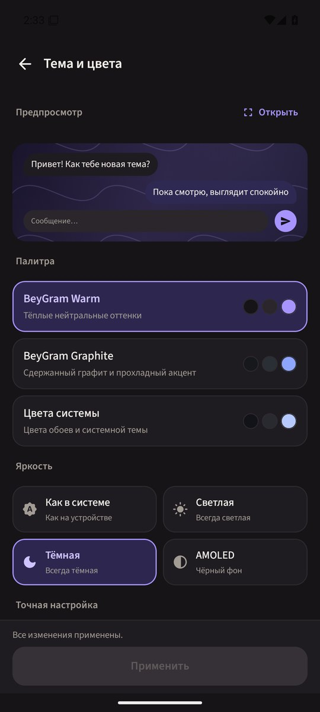 | 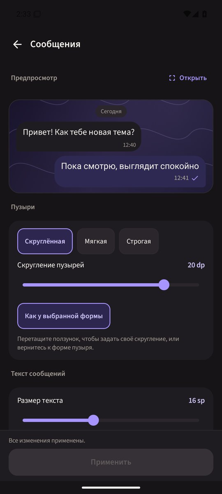 | 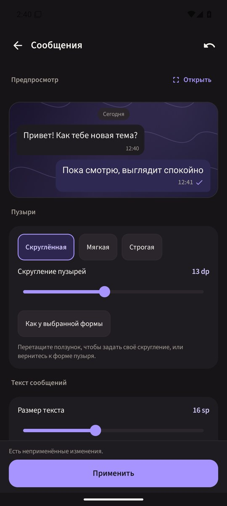 |

| Animations | Wallpapers | Photo wallpaper |
| --- | --- | --- |
| 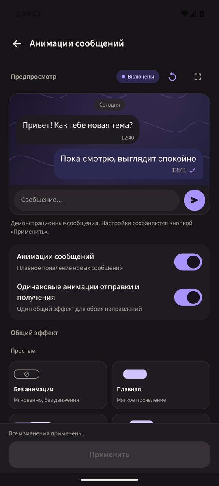 | 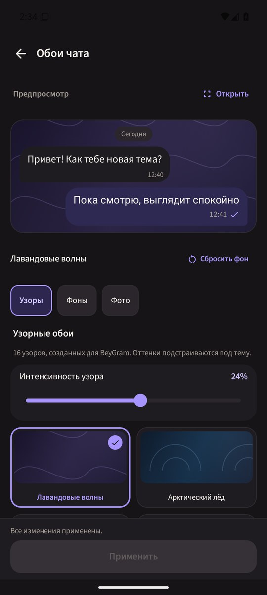 | 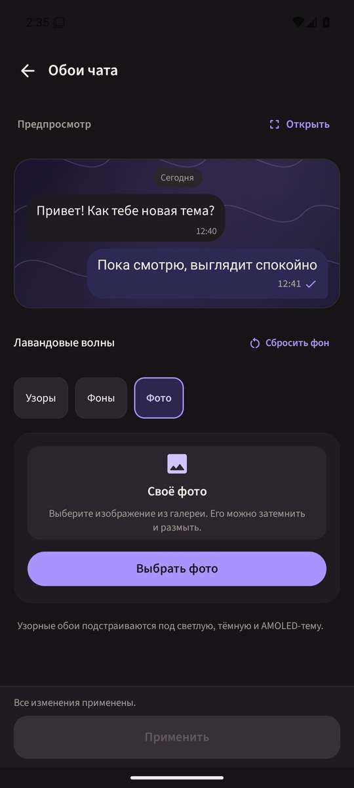 |

| Custom colours | Full preview |
| --- | --- |
| 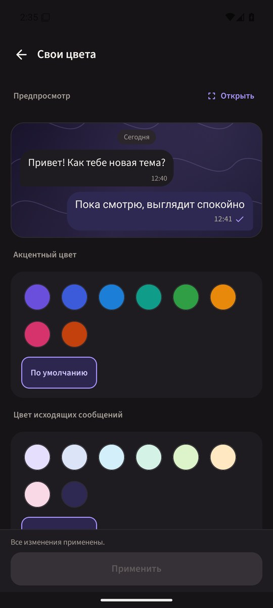 | 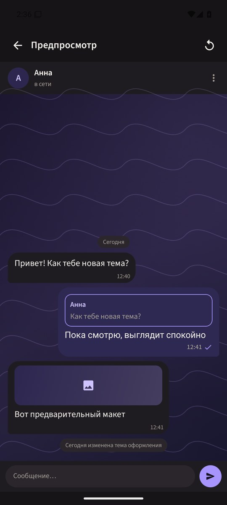 |

In landscape the overview keeps the Preview/Open row but drops the inline chat fragment so the section list remains
reachable; the Apply bar becomes one compact row.

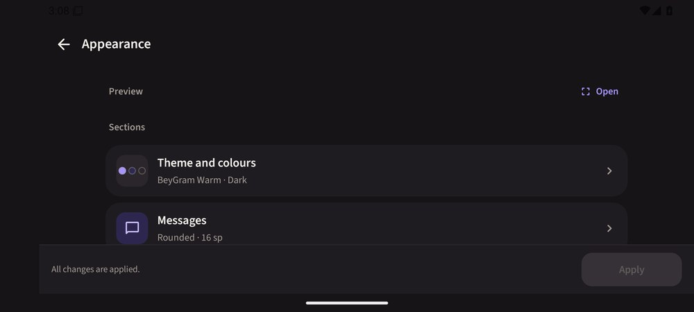

The screenshots come from a debug-only visual harness (`AppearancePreviewHarnessActivity`) on an Android 15
emulator at 1080×2400, with no account or TDLib data. The harness exists only in the debug source set.

## Verification

Local checks performed during development:

- `:app:assembleDevDebug`
- targeted JVM tests for appearance data, draft restoration, theme tokens and English resource coverage
- eight appearance instrumentation tests on the emulator: navigation, apply, undo, system Back, discard safety,
  Activity recreation, preview composition, wallpaper selection and colour swatch accessibility
- screenshots in dark, light and AMOLED modes, plus 1.3× and 2.0× system font scale checks

The full JVM suite still contains pre-existing `AccessDeniedException` failures in TDLib account tests on this
Windows host; the appearance/data/theme subset passes. Lint reports pre-existing errors in unrelated files (for
example notification permission checks); the new appearance files add no lint errors.

Known limits of this development pass:

- the real-device UI was not touched, per `AGENTS.md`;
- the gallery picker was not exercised end-to-end with a real photo on the emulator; the import and preview code
  paths are unchanged and listed in the manual QA plan below;
- the full JVM suite was not green because of the unrelated Windows TDLib test failures above.

## Manual QA still worth doing on a real phone

1. Open Appearance from Settings, change palette/brightness, open every subsection, rotate, and apply.
2. Enter independent animation mode, choose a different preset for received messages, replay, and verify the
   incoming/outgoing demonstration uses both choices.
3. Choose Composer Launch, replay from the preview and from full preview, and confirm the field clears and the
   bubble lands on the destination.
4. Import a gallery photo, adjust dim/blur, apply, reopen Appearance, and confirm the file survives.
5. Rotate and increase Android font scale while editing; confirm no button, slider or chip is clipped.
6. Change several settings, press system Back twice from a subsection, cancel the discard dialog, then Undo and
   confirm the previous draft returns.
